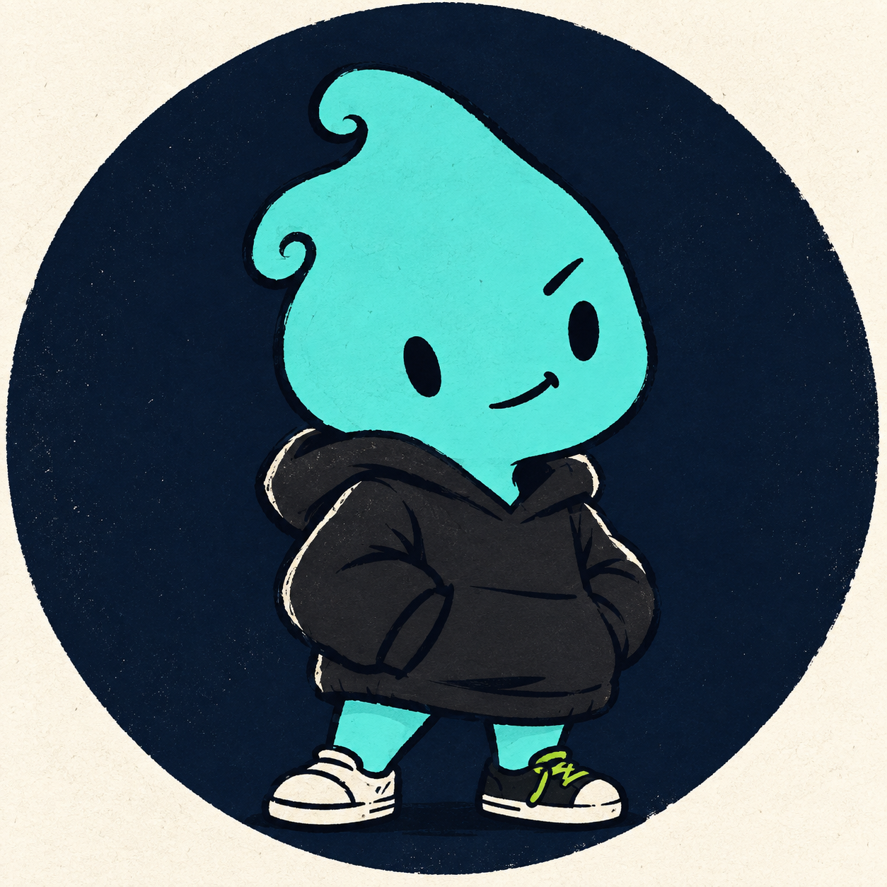

  
  <h1>Hey, I'm Genes.</h1>
  
<strong>Python learner · Curious builder · Always improving</strong>

### About me

- 🐍 Learning Python by building real projects
- 🛠️ Interested in automation, data, and useful developer tools
- 🌱 Improving one project and one commit at a time
- 🎯 Focused on writing simple, understandable code

### Currently building

[**genes-drafter-data**](https://github.com/enes061061/genes-drafter-data) — a Python-based project that I'm actively developing and improving.

### Tools I use

  
  
  

---

  Learning in public and building with purpose.

